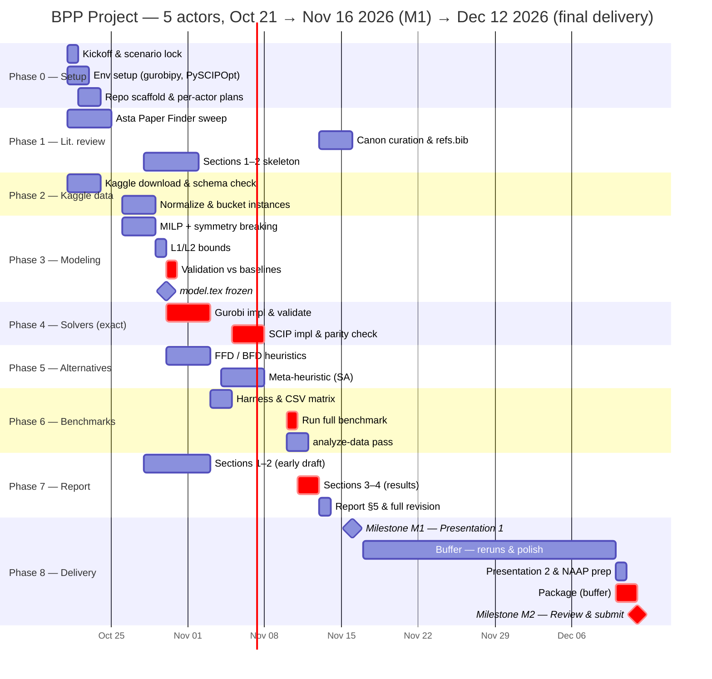

# Bin Packing Problem (BPP) — Project Plan
**Disciplina:** SME 0110 – Programação Matemática · **Prazo:** Oct 21 → **Nov 16, 2026 (Presentation 1)** · **Dec 12, 2026 (final delivery — placeholder, TBC)**
**Description source:** [`Projeto_PM_BCC_2026.pdf`](./Projeto_PM_BCC_2026.pdf) / [`Projeto_PM_BCC_2026.md`](./Projeto_PM_BCC_2026.md)

> **Objective:** model & solve the Bin Packing Problem for one real-world application
> using a commercial solver (**Gurobi**), a free solver (**SCIP**), and one alternative
> method (heuristic FFD/BFD or meta-heuristic), producing a technical report
> (ABNT/IEEE) and two presentations. Deliverables: code + instances + PDF report in a
> single archive on e-disciplinas. Grading: NM 3 · NI 4 · NR 3 · NA 1 · NAAP 1,
> `NT = (NM + NI + NR) · min{NA, NAAP}`. **Plagiarized/duplicated work → zero.**

---

## 1. Scenario choice (deliberation)

- **Chosen application:** *Alocação de Cargas em Veículos / Contêineres* — minimize the
  number of trucks/containers needed to transport a set of goods with limited
  weight/volume capacity. Maps 1:1 onto the generic MILP from the project brief
  (items = boxes; bins = trucks with capacity C).
- **Dataset (chosen — tentative):** [Supply Chain Logistics Optimization Dataset](https://www.kaggle.com/datasets/omarstat2/supply-chain-logistics-data)
  (Brunel University London research data) — `OrderList` with **9,215 real customer
  orders** (weights, units, shipping dates, ports); BPP mapping: items = order
  lines, `w_i` = order weight, bins = trucks/containers, `C` from the freight
  weight brackets (`FreightRates`). Details in `DATASETS.md` §1. **Tentative — may
  be swapped; revisit Phase 2 if so.** Fallback: the Pick and Place Binning Dataset
  (synthetic, greedy baselines) remains the tuned-on reference benchmark.
- **Real-dataset candidates per use case:** see [`DATASETS.md`](./DATASETS.md)
  (researched Oct 2026). Recommended hybrid: tune on the synthetic instances, then
  validate on a preprocessed real set (e.g., ENEM questions or Azure VM packing
  requests) — a real-data story the report can present honestly.

## 2. Actors (5 independent lanes)

| Actor | Role | Primary deliverables |
|---|---|---|
| **A1 — Lead & Modeling** | Coordination; MILP formulation, symmetry-breaking constraints, lower bounds (L1/L2) | `model.tex` (Set/Params/Vars/Objective/Constraints), bound module |
| **A2 — Literature & Report** | Asta-backed literature review (ABNT/IEEE), report drafting against the 5 mandated sections | `refs.bib`, `relatorio.pdf` sections 1–2, 5 |
| **A3 — Data Engineering** | Kaggle dataset acquisition, parser to standard BPP format, instance buckets (small/medium/large), experiment harness | `data/` instances, `harness.py` |
| **A4 — Exact Solvers** | Gurobi (commercial) + SCIP (free) implementations, tuning, result logging | `solver_gurobi.py`, `solver_scip.py`, `results_exact.json` |
| **A5 — Alternative Methods** | FFD/BFD heuristics + one meta-heuristic (SA or Tabu); quality analysis vs optimum/LB | `heuristics.py`, `results_heur.json` |

Lanes are independent; **sync points** are the milestones M1 (intermediate presentation, Nov 16) and M2 (final delivery, Dec 12 — placeholder, TBC).

## 3. Work breakdown (checkbox plan)

### Phase 0 — Setup & kickoff (Oct 21–22, starts TODAY) — *All / A4*
- [ ] Kickoff meeting TODAY (Oct 21): confirm scenario, register group on e-disciplinas (A1)
- [ ] Env setup: Python venv/devenv; `gurobipy` (academic license), `PySCIPOpt` + SCIP binary — **parallel to everything else (A4)**
- [ ] Repo scaffold: `data/`, `src/`, `report/`, `work/` (A1)
- [ ] Freeze per-actor sub-plans on Oct 22, no re-planning later (A1)

### Phase 1 — Literature research with Asta (Oct 21–30) — *A2 (+A1)*
- [ ] Query `asta literature find` + Asta Paper Finder for BPP surveys & formulations (Oct 21–26)
- [ ] Pin canon via Asta `semantic-scholar` lookups (Oct 27–28):
    - Coffman, Garey & Johnson (1997), "Approximation Algorithms for Bin Packing: A Survey"
    - Johnson (1973) & Dósa (2007) — tight bound FFD ≤ (11/9)·OPT + 6/9
    - Martello & Toth (1990), L1/L2 lower bounds
    - Gilmore & Gomory (1961) — column-generation alternative formulation
    - Wäscher, Haußner & Schumann (2007) — cutting & packing typology
- [ ] Collect 8–12 cited sources → `refs.bib` (ABNT or IEEE) (Oct 28–30)
- [ ] Draft `report/01-introducao.md` + `report/02-modelagem.md` skeleton referencing the review (Oct 28 – Nov 3, runs in parallel with Phase 3's modeling by A1)

### Phase 2 — Dataset acquisition from Kaggle (Oct 21–28) — *A3*

> **Note (dataset switch):** the chosen dataset is now the Supply Chain Logistics
> Optimization Dataset (tentative — see §1). The steps below still describe the
> previous Pick and Place pipeline; parser/bucketing details will be rewritten
> once the dataset choice is confirmed.
- [ ] Download via Kaggle API / MCP tools: `tools.kaggle.download_dataset` for `panavraaj/pick-and-place-binning-dataset` (Oct 21–23)
- [ ] Parse to normalized BPP instance format (list of `w_i` + capacity `C`); sanity: `C ≥ max(w_i)` (Oct 21–23)
- [ ] Record provenance + license in `data/README.md` (Oct 21–23)
- [ ] Split into buckets: toy (3–10), medium (40), large (100–200, **large is heuristic-only** vs compressed timeline) (Oct 26–28)
- [ ] For the real-instance validation set: preprocess chosen real dataset per `DATASETS.md` §6 (Oct 26–28) — synthetic tuning first, real validation after

### Phase 3 — Mathematical modeling & model validation (Oct 26–30) — *A1*
- [ ] Adapt generic model from the brief: min ∑y_j; s.t. ∑_j x_ij = 1 ∀i; ∑_i w_i x_ij ≤ C·y_j ∀j; x,y ∈ {0,1} (Oct 26–28)
- [ ] Add strengthening: symmetry-breaking `y_j ≥ y_{j+1}`; tighter big-M (C replaced by max useful load) (Oct 26–28)
- [ ] Implement LB modules: L1 = ⌈∑ w_i / C⌉; L2 (Martello–Toth) (Oct 28–29)
- [ ] Validate toy instances vs. Kaggle `greedy_cost` baselines & L1/L2 (Oct 30); freeze `model.tex` — **critical handoff to A4**

### Phase 4 — Exact solvers (Oct 30 – Nov 7) — *A4*
- [ ] Gurobi prototype on toy bucket; validate optima agree with L1/L2 bounds & Kaggle greedy baselines (Oct 30 – Nov 4)
- [ ] SCIP equivalent; log per run: status, objective, runtime, optimality gap (Nov 5–6)
- [ ] Parity check Gurobi ↔ SCIP on toy bucket (Nov 7)
- [ ] Produce `results_exact.json` for toy+medium buckets (Nov 7)
- [ ] Scope guardrail: **no per-solver deep tuning** (MIPFocus sweep, seed studies) — single sensible configuration only

### Phase 5 — Alternative methods (Oct 30 – Nov 7) — *A5*
- [ ] Implement FFD + BFD as documented in Coffman et al.; test on toy bucket (expect ≤ optimum+1) (Oct 30 – Nov 3)
- [ ] Implement **one** meta-heuristic — recommended: Simulated Annealing over item ordering + First-Fit decode (Nov 4–6)
- [ ] Compare quality vs MILP optima & LB on toy/medium buckets (Nov 7)
- [ ] Produce `results_heur.json` for **all** buckets (large included — heuristics scale fine) (Nov 7)
- [ ] Scope guardrail: **no parameter sweeps** — fixed sensible SA schedule; drop Tabu variants

### Phase 6 — Benchmarking & analysis (Nov 3–11) — *A3 (+A4, A5)*
- [ ] Harness in `harness.py`: deterministic single seed + time limit; one CSV row per (solver × method × instance) (Nov 3–4)
- [ ] Run matrix: {Gurobi, SCIP, FFD, BFD, SA} × {toy, medium, large} — **primary seed, fixed time limit** (Nov 10)
- [ ] `analyze-data` pass on results CSV for status/obj/time/gap tables (Nov 10–11)
- [ ] Scope guardrail: reruns with a second seed are the **buffer activity** — only if the spine is still on schedule by Nov 13

### Phase 7 — Report drafting (Oct 28 – Nov 13) — *A2 (+A1)*
- [ ] Sections 1–2 (introduction + mathematical modeling) drafted **early** from literature + `model.tex` (Oct 28 – Nov 5)
- [ ] Section 3 (solver results & comparison) from `results_exact.json` (Nov 11–12)
- [ ] Section 4 (alternative method & critical analysis) from `results_heur.json` (Nov 11–12)
- [ ] Section 5 (conclusion, future work: 2D/3D, heterogeneous bins, hybrid) (Nov 13)
- [ ] LaTeX → PDF; similarity check (plagiarism → zero rule) (Nov 13)

### Phase 8 — Deliverables (Nov 16 / Dec 10–12) — *All*
- [ ] **M1: intermediate presentation** (Nov 16) — must show modeling + complete solver runs + heuristics in progress
- [ ] *Buffer window (Nov 17 – Dec 9):* absorb Presentation 1 feedback; second-seed reruns (only if the spine is on schedule); report polish
- [ ] Presentation 2 prep & peer/self assessment tasks (NAAP) (Dec 10)
- [ ] Final packaging: code + instances + PDF → single `zip/rar/tar.gz` (Dec 10–11 — written while reviewers double-check)
- [ ] Review & submit (**Dec 12 — placeholder date, confirm with the professor**)

> **Scheduling assumptions (Oct 21 start → Nov 16 Presentation 1 → Dec 12 final delivery):** the spine still runs to
> Presentation 1 (Nov 16) unchanged; the Nov 17 – Dec 9 window is open buffer (feedback absorption, seed reruns,
> report polish). Packaging lands Dec 10–11 and submission on Dec 12 — a **placeholder** to be confirmed with the
> professor. The team works through weekends and holidays alike (including the Nov 2 Finados holiday).

## 4. Gantt overview

> **Note on the critical path:** Model freeze (Oct 30) → Gurobi (Nov 2) → SCIP
> (Nov 6) → benchmark run (Nov 10) → results sections (Nov 12) → revision/PDF
> (Nov 13) → **Presentation 1 (Nov 16)** → the **Nov 17 – Dec 9 window becomes
> wide buffer** (seed reruns, report polish, presentation-feedback absorption) →
> packaging (Dec 10–11) → submission (Dec 12 — placeholder). The spine keeps a
> **2-day packaging buffer** (Dec 10–11) plus ~3 weeks of post-presentation
> slack. The buffer absorbs slips from the spine: if SCIP runs early, spend it
> on seed reruns and deeper report polish, not on new features. As before,
> A2/A3 lanes (literature, data) complete in week 1 and are designated assist
> lanes for the spine.

### Scope guardrails (lightened vs the Nov 11 compression, still in force)

1. **One** meta-heuristic (SA only), no Tabu/GA variants.
2. **Primary benchmark seed + one rerun seed** — the rerun is a *buffer activity*, never a blocker.
3. Large bucket (100–200 items) remains **heuristics-only**; exact solvers prove toy/medium only.
4. Real-dataset validation limited to **one** chosen real set (per `DATASETS.md` §6) — prep-only after Oct 28; it may be dropped entirely if the spine slips, with honest reporting of synthetic-only results.
5. Presentation 1 feedback is *absorbed*, not re-planned.
