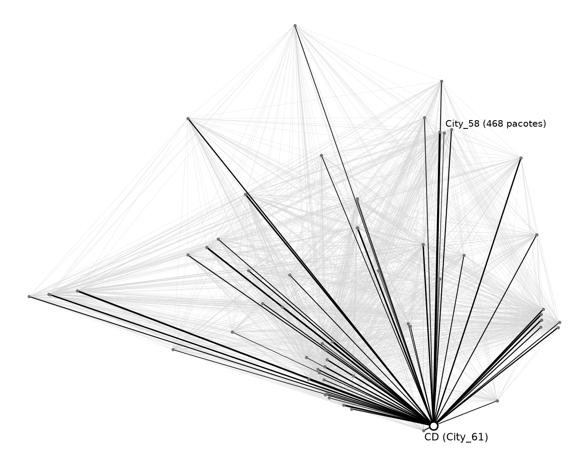
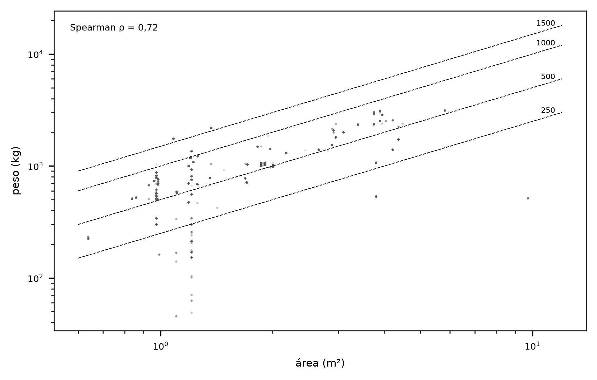
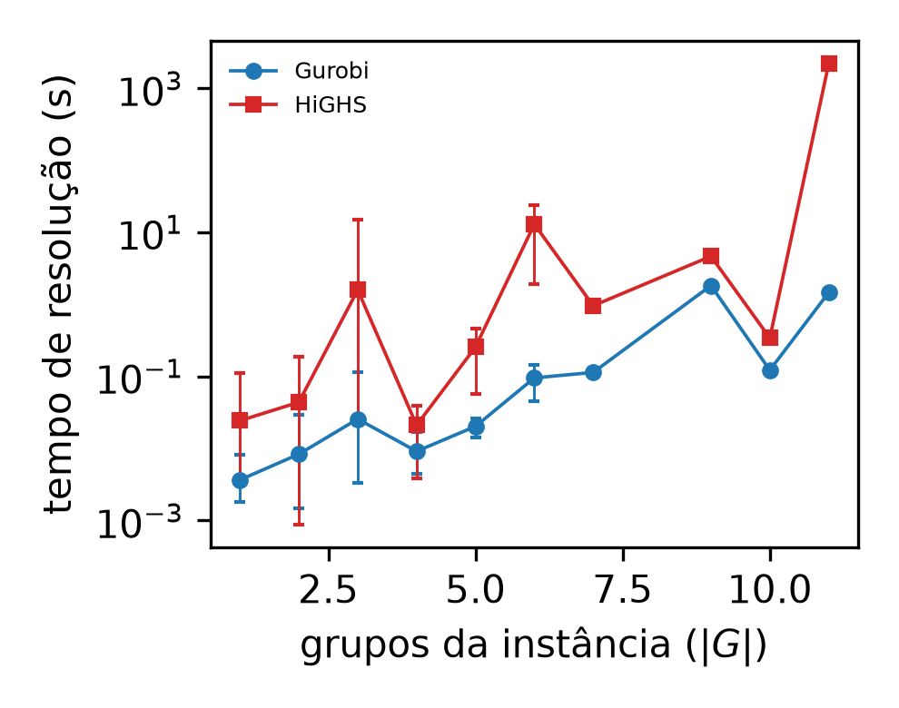
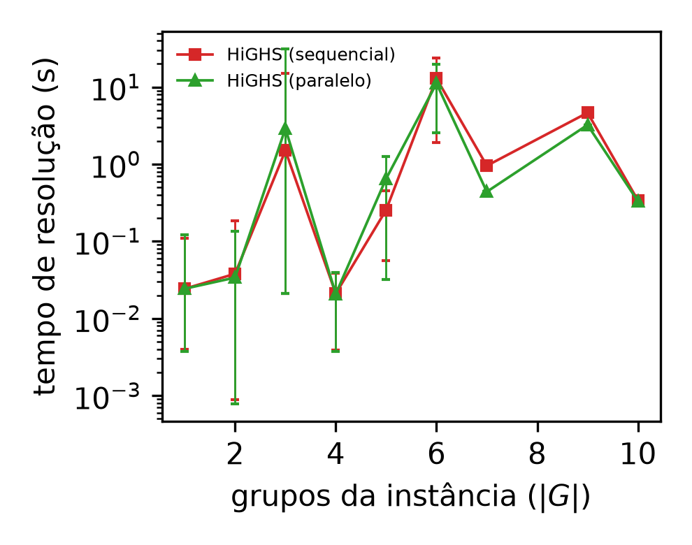

<!-- jump_to_middle -->

INTRODUÇÃO
==========

Contextualização
----------------

<!-- column_layout: [1, 3] -->

<!-- column: 0 -->

# Tema

_Alocação de cargas em veículos_

<!-- pause -->

<!-- column: 1 -->

# Dataset

**Título:** Large-Scale Route Optimization Accelerator

**Autores:** Microsoft, et al.

**Fonte:** https://github.com/microsoft/dstoolkit-route-optimization

> Trata-se de um benchmark para o **Problema do Roteamento de Veículos (Vehicle
> Routing Problem - VRP)**

Adaptação
---------

<!-- column_layout: [1, 1] -->

<!-- column: 0 -->

Ao reduzir o número máximo de paradas para `1` o VRP degenera para um
**Problema de Empacotamento com Compartimentos de Tamanho Variável (Variable
Sized Bin Packing Problem - VSBPP)**

<!-- pause -->

> **Projeção da matriz de distâncias**; em preto, as 61 rotas diretas a partir de CD (City_61).

<!-- column: 1 -->




<!-- end_slide -->

<!-- jump_to_middle -->

Análise Estatística Exploratória
===

Correspondência entre parâmetros e o vocábulo do VSBPP
---


| Parâmetro          | Correspondência com o VSBPP |
| ------------------ | --------------------------- |
| Pacotes            | Itens                       |
| Frota de caminhões | _Bins_                      |
| Pedidos x Rotas    | Instâncias de VSBPP         |


Pacotes
---

<!-- column_layout: [2, 3] -->

<!-- column: 0 -->

**4.635** unidades, em um total de **235** classes distintas.

<!-- pause -->

# Características

- Área

- Peso

## Herdadas do Pedido

- Disponibilidade

- Prazo de entrega

<!-- column: 1 -->

<!-- pause -->



> Gráfico Área × peso dos pacotes (escala logarítmica); as retas tracejadas marcam densidades constantes.


Frota
---

<!--pause-->

# 4 variedades de caminhão

O VSBPP difere do BPP clássico ao admitir compartimentos de capacidade variável. O objetivo passa a ser o custo total dos compartimentos usados.

<!-- pause -->

## Características

| Compr. (m) | Área (m²) | Peso (kg) | Custo (US$/km) | Custo/m²  | Custo/kg  | Densidade (kg/m²) |
| ---------: | --------: | --------: | -------------: | ----------------: | ----------------: | ----------------: |
|        7,6 |     16,56 |     8.000 |            5,5 |             0,332 |           0,00069 |               483 |
|        9,6 |     20,93 |    14.000 |            6,5 |             0,311 |           0,00046 |               669 |
|       12,5 |     30,25 |    24.000 |            9,0 |             0,298 |           0,00038 |               793 |
|       16,5 |     40,25 |    27.000 |           10,0 |             0,248 |           0,00037 |               671 |

> **Nota:** as colunas Custo/m² e Custo/kg dividem o custo por km pela referida capacidade **total** do
caminhão.

Área × peso enquanto fatores limitantes
---

<!-- column_layout: [2, 2] -->

<!-- column: 0 -->


<!-- column: 1 -->

> Caminhões por destino, se a frota fosse só de veículos de 16,5 m: limite por área contra limite por peso (eixos log₂). A área de cada ponto é proporcional ao número de destinos com o mesmo par de limites.


Pedidos
---

Agrupamentos de pacotes com os mesmos parâmetros de disponibilidade e prazo.

Características dos pedidos
---

<!-- column_layout: [2, 1] -->

<!-- column: 0 -->


<!-- column: 1 -->

<!-- incremental_lists: true -->

- Heterogêneos no volume de pacotes

<!-- speaker_note: Distribuição em forma de calda longa com mediana (`10`) abaixo da média e elevado nível de variância (média de `12,7 ± 9,9`). Os `10%` dos pedidos mais volumosos concentram quase `27,5%` dos pacotes, enquanto os 50% dos pedidos menos volumosos juntos concentram `21,6%`. -->

- Homogêneos nas classes de pacotes

<!-- speaker_note: No máximo `4` variedades por pedido, na esmagadora maioria dos casos (`86.6%`) os pacotes são todos da mesma classe. -->

Disponibilidade dos pedidos
---

<!-- column_layout: [2, 1] -->

<!-- column: 0 -->


<!-- column: 1 -->

- A grande maioria dos pacotes é liberada em um mesmo horário: `23:59:59`

- Há pouco aprimoramento que pode ser feito com a janela de consolidação (`Δh - 4`) e forte separação na disponibilidade de pacotes entre dias (8 horas sem estarem disponíveis novos pacotes todo dia).

Rotas
---

# Poucos pedidos concentram muitos pacotes, e poucas rotas concentram muitos pedidos

| Demanda | 6 maiores rotas (%) | Rotas até 90% | Gini |
| --------------- | --------------- | --------------- | --------------- |
| Pacotes | 35,3 | 33 | 0,55 |
| Peso | 38,5 | 32 | 0,57 |
| Área | 43,6 | 31 | 0,61 |

<!-- end_slide -->

<!-- jump_to_middle -->

MODELAGEM MATEMÁTICA
===

Conjuntos
---

<!-- column_layout: [1, 1] -->

<!-- column: 0 -->

<!-- pause -->

# Grupos de pacotes idênticos

```latex +render
$G = \{1, \dots, \mid G \mid \}$
```

Cada qual com multiplicidade

```latex +render
$n_g \mid n, g \in  Z^*$
```

<!-- column: 1 -->

<!-- pause -->

# Tipos de caminhões disponíveis

```latex +render
$T = \{1, ..., 4\}$
```

# _Slots_ de caminhão disponíveis

```latex +render
$J = \{1, ..., m\}, m \le n \mid n = \sum_g n_g$
```

<!-- end_slide -->

<!-- column_layout: [1, 2] -->

<!-- column: 0 -->

Parâmetros
---

> Consolidação das tabelas IV–VII do relatório: apenas os parâmetros que entram no modelo.

<!-- column: 1 -->

| Parâmetro  | Descrição                  | Coluna               | Unidade |
| ---------- | -------------------------- | -------------------- | ------- |
| `g`        | grupo de pacotes idênticos | derivado             | ---     |
| `a_g`      | área de um pacote          | `Area`               | m²      |
| `w_g`      | peso de um pacote          | `Weight`             | kg      |
| `av_g`     | disponibilidade do grupo   | `Available_Time`     | h       |
| `dl_g`     | prazo do grupo             | `Deadline`           | h       |
| `d`        | distância da rota          | `Distance(M)`        | km      |
| `t`        | índice do tipo de caminhão | `truck_type`         | ---     |
| `A_t`      | capacidade de área         | `area_capacity_m2`   | m²      |
| `W_t`      | capacidade de peso         | `weight_capacity_kg` | kg      |
| `c_t`      | custo por quilômetro       | `cost_per_km`        | US$/km  |
| `v`        | velocidade do caminhão     | `speed_kmh`          | km/h    |
| `C_t`      | custo fixo por viagem      | derivado (`c_t d`)   | US$     |
| `t_viagem` | tempo de viagem            | derivado (`d/v`)     | h       |
| `Δ`        | janela de consolidação     | política (4 h)       | h       |
| `M`        | constante de desativação   | derivado             | h       |

Variáveis de decisão
---

<!-- column_layout: [3, 2] -->

<!-- column: 0 -->

<!-- pause -->

# Quantos pacotes do grupo `g` viajam no caminhão `j`

```latex +render
$z_{gj} \in \{ 0, 1, \dots, n_g \}$
```

<!-- pause -->

# Se ao menos um pacote do grupo `g` viaja no caminhão `j`

```latex +render
$u_{gj} \in \{0, 1\}$
```

<!-- column: 1 -->

<!-- pause -->

# Se o caminhão `j` é do tipo `t`

```latex +render
$y_{jt} \in \{ 0, 1 \}$
```

<!-- pause -->

# O instante de partida do caminhão `j`

```latex +render
$\tau_j \ge 0$
```

Função objetivo
---

```latex +render
$\min \sum_{j \in J} \sum_{t \in T} C_t \times y_{jt}$
```

Restrições (R1-R4)
---

<!-- column_layout: [1, 1] -->

<!-- column: 0 -->

# R1 - Atribuição completa dos pacotes

```latex +render
$\sum_{j \in J} = n_g, \forall g \in G$
```

# R2 - Capacidade de área

```latex +render
$\sum_{g \in G} a_g z_{gj} \le \sum_{t \in T} A_t y_{jt},\ \forall j \in J$
```

<!-- column: 1 -->

# R3 - Capacidade de carga

```latex +render
$\sum_{g \in G} w_g z_{gj} \le \sum_{t \in T} W_t y_{jt}\ \forall j \in J$
```

# R4 - Um tipo por caminhão

```latex +render
$\sum_{t \in T} y_{jt} \le 1,\ \forall j \in J$
```

Restrições (R5-R8)
---

<!-- column_layout: [1, 1] -->

<!-- column: 0 -->

# R5 - Vínculo entre grupo de pacotes e caminhões

```latex +render
$z_{gj} \le n_g \sum_{t \in T} y_{jt},\ \forall g \in G, j \in J$
```

# R6 - Ocupação do grupo em cada caminhão

```latex +render
$u_{gj} \le z_{gj} \le n_g u_{gj},\ \forall g \in G,\ j \in J$
```

<!-- column: 1 -->

# R7 - Partida após disponibilidade

```latex +render
$\tau_j \ge av_g - M(1 - u_{gj}),\ \forall g \in G,\ j \in J$
```

# R8 - Janela de consolidação

```latex +render
$\tau_j \le av_g + \Delta + M (1 - u_{gj})\ \forall g \in G,\ j \in J$
```

Restrições (R9-R10)
---

# R9 - Chegada dentro do prazo

```latex +render
$\tau_j \le dl_g - t_{viagem} + M(1 - u_{gj})\ \forall g \in G,\ j \in J$
```

# R10 - Quebra de simetria

```latex +render
$\sum_{t \in T} y_{jt} \ge \sum_{t \in T} y_{y + 1, t}\ \forall j \in \{1, \dots, m - 1\}$
```

<!-- end_slide -->

<!-- jump_to_middle -->

EXPERIMENTO: SOLUÇÃO EXATA
===

Pré-processamento
---

<!-- column_layout: [1, 1] -->

<!-- column: 0 -->

<!-- pause -->

# Recorte

Separamos os pedidos em função da rota e o dia de disponibilidade em instâncias separadas de VSBPP.

<!-- pause -->

# Normalização

Para cada instância:

1. Converte-se as _timestamps_ para uma contagem de horas

<!-- speaker_note: à partir da origem da instância -->

1. Agrupa-se e ordena-se pacotes idênticos

<!-- speaker_note: em função de da maior área; e peso em caso de empate -->

<!-- column: 1 -->

<!-- pause -->

# Redução do modelo

Para cada instância, aplica-se

- **Filtro de tipos**

<!-- speaker_note: Admite-se apenas caminhões capazes de carregar o menor pacote disponível. -->

- **Teto de slots**

<!-- speaker_note: Utiliza-se a heurística _First Fit Decreasing (FFD)_ para calcular um teto de caminhões a serem utilizados na solução ótima. -->

- **Fechamento por inspeção**

<!-- speaker_note:  Quando a carga inteira cabe em um único caminhão e a janela de tempo permite, é esta a solução ótima e não há MILP a se resolver. -->

Protocolo experimental
---

<!-- incremental_lists: true -->

- Ambos os solvers recebem o **mesmo modelo** e os **mesmos parâmetros** para execução.

<!-- speaker_note: fazendo uso da função `LpProblem` da biblioteca **PuLP** para geração do modelo -->

- Cada execução (instância × solver) popula a pasta `data/results` com arquivos CSV relativos a solução e as variáveis de decisão a esta associadas.

- Durante execução logs são salvos na pasta `data/results/logs`.

<!-- speaker_note: (não versionada) -->

<!-- end_slide -->

<!-- jump_to_middle -->

RESULTADOS E DISCUSSÃO
===


Resultados
---

<!-- pause -->

# Valor ótimo

Os dois solvers devolvem o mesmo valor ótimo dentro de uma margem de erro de 0,01%.

<!-- speaker_note: Ou seja, um centavo para mais ou para menos, o que equivale a margem de tolerância padrão do HiGHS -->

<!-- pause -->

# Variáveis de decisão

Nas 111 instâncias:

- A escolha de caminhões coincide completamente em 70 instâncias

- Divergem apenas na ordenação dos caminhões em 35

- Divergem na composição da frota em 6

Desempenho
---

<!-- column_layout: [3, 2] -->

<!-- column: 0 -->

# Tempo médio de resolução



<!-- column: 1 -->

<!-- pause -->

# Métricas de benchmark

| Métrica | Gurobi | HiGHS |
| --- | ---: | ---: |
| Execuções | 111 | 111 |
| Tempo total (s) | 4,4 | 2.233,4 |
| Tempo mediano (s) | 0,00 | 0,03 |
| Tempo médio (s) | 0,06 | 33,33 |
| Tempo p90 (s) | 0,06 | 1,00 |
| Tempo máximo (s) | 1,82 | 2.180,41 |
| Gap máximo (%) | 2,1×10⁻⁶ | 0,0100 |


Análise
---

<!-- pause -->

```log
Solving MIP model with:
   499 rows
   221 cols (130 binary, 78 integer, 0 implied int., 13 continuous, 0 domain fixed)
   1604 nonzeros
   Thread count 8 (of 20 threads). Using 1 max workers. Parallel search off
```

> Trecho do arquivo `HiGHS__City_5_2022-04-06.log`

Adaptação
---

<!-- column_layout: [1, 1] -->

<!-- column: 0 -->

# Tempo médio de resolução



<!-- column: 1 -->

<!-- pause -->

# Métricas de benchmark


| Métrica | Sequencial | Paralelo |
| --- | ---: | ---: |
| Execuções | 64/111 | 64 |
| Tempo total (s) | 50,3 | 60,9 |
| Tempo mediano (s) | 0,02 | 0,02 |
| Tempo médio (s) | 0,79 | 0,95 |
| Tempo p90 (s) | 0,42 | 0,41 |
| Tempo máximo (s) | 24,03 | 31,06 |
| Gap máximo (%) | 8,3×10⁻³ | 8,7×10⁻³ |


Conclusão
---

<!-- incremental_lists: true -->

- Gurobi obteve obteve desempenho superior em média.

<!-- speaker_note: Isso, enquanto apresentando mesma solução. -->

- Forçar a paralelização da execução do solver HiGHS não implica em ganho de desempenho.

<!-- speaker_note: E nas instancias mais duras pode ser destrutivo -->

<!-- end_slide -->

<!-- jump_to_middle -->

OBRIGADO
===

<!-- pause -->

<!-- column_layout: [3, 2] -->

<!-- column: 0 -->

Documentação e os códigos utilizados podem ser encontrados em [nosso repositório](github.com/o-abreu/bin-packing-problem)
